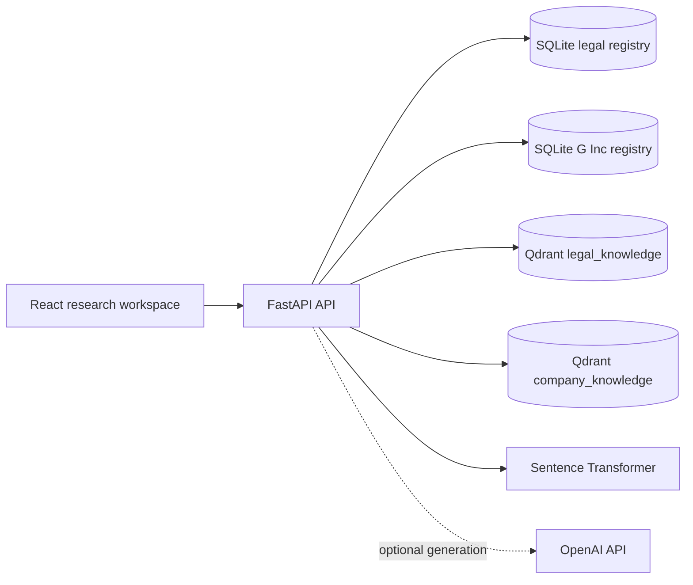

# A Precision-Oriented Retrieval-Augmented Legal Compliance Assistant

## System design and evaluation protocol

**Article type:** Research prototype and evaluation protocol  
**Project:** Global Compliance Intelligence  
**Version:** 0.3  
**Status:** Manuscript draft; not peer-reviewed  
**Last updated:** November 2026

> **Research status.** This article reports a prototype and a proposed empirical study. It does not claim measured legal accuracy, a completed multi-agent system, or a validated compliance product. Evaluation results are not yet available.

### Abstract

Organizations need to find applicable legal requirements, inspect their own policies, and preserve enough provenance for reviewers to check the analysis. A fluent language-model answer alone does not establish that a provision is authoritative, current, or supportive of the claim. This paper presents Global Compliance Intelligence, a research prototype for evidence-grounded legal question answering and a local, single-company policy-review demonstration. The legal pipeline accepts PDF and DOCX files, extracts selectable text, preserves recognized legal headings as section metadata, stores document records in SQLite, and indexes dense vectors in embedded Qdrant. A separate collection and registry store fictional G Inc Markdown policy drafts. The review workflow retrieves legal and company evidence independently, optionally asks an OpenAI model for structured findings, and checks that returned evidence identifiers belong to the retrieved set. This check verifies identifier provenance, not semantic entailment. The current system is a dense-retrieval baseline with one Indian DPDP-focused demo scope; it does not implement hybrid search, reranking, multi-agent orchestration, cross-jurisdiction comparison, production tenant security, or regulatory monitoring. We define a reproducible evaluation protocol for comparing dense, hybrid, and future multi-agent systems using retrieval, citation, faithfulness, abstention, latency, and cost measures. No quantitative results are reported because the legal corpus and adjudicated question set are not yet complete.

**Keywords:** legal information retrieval; retrieval-augmented generation; compliance; evidence provenance; citation verification; evaluation

---

## 1. Introduction

Legal and compliance work involves more than finding text that resembles a question. A useful research assistant must preserve the source, provision, version, and temporal context of its evidence. It must also be able to say when the indexed corpus does not answer the question. Retrieval-augmented generation (RAG) conditions a language model on retrieved documents [1], but retrieval alone does not guarantee completeness or prove that a cited passage supports a claim.

Global Compliance Intelligence is intended to grow into a platform for multi-jurisdiction legal research and company-policy review. The current codebase implements a narrower, inspectable slice: dense legal retrieval and a local G Inc comparison demonstration. This article documents that scope, describes the present design, and proposes an evaluation that can test later improvements without assuming that additional model calls improve accuracy.

### Research questions

- **RQ1:** How well does dense retrieval return human-labeled relevant legal sections for questions over a curated corpus?
- **RQ2:** Does hybrid retrieval with rank fusion and reranking improve retrieval and citation measures over the dense baseline?
- **RQ3:** Does bounded multi-agent orchestration improve citation completeness and answer faithfulness enough to justify additional latency and cost?
- **RQ4:** How reliably does the system abstain when evidence is weak, missing, contradictory, or temporally inapplicable?

These remain research questions. The current prototype has not been evaluated against an annotated legal dataset.

## 2. Related work

Lewis et al. describe RAG as a combination of parametric generation and non-parametric retrieved knowledge [1]. Sentence-BERT uses siamese and triplet network structures to generate sentence embeddings that can be compared using cosine similarity [2]. Reciprocal Rank Fusion (RRF) combines ranked results without requiring raw retrieval scores to share a common scale [3]. These works motivate the prototype's dense baseline and planned hybrid-retrieval comparator; they do not establish performance on the present corpus.

LegalBench is a collaboratively built benchmark that treats legal reasoning as a collection of distinct tasks rather than a single capability [4]. The evaluation proposed here focuses specifically on legal-section retrieval, citation support, evidence-grounded answers, and abstention. It is not a replacement for a broader legal reasoning benchmark.

## 3. System design

### 3.1 Local architecture

The documented local setup uses FastAPI, SQLite, embedded Qdrant, and a React/Vite frontend. Redis is optional and is not used for background jobs. The backend exposes separate versioned routes for legal documents, questions, and the G Inc demo workspace. FastAPI startup uses a lifespan handler to prepare local storage.

**Figure 1.** Current local application components. Legal and company records and vectors are stored separately. The optional language model is used only when configured.

| Component | Current implementation | Boundary |
|---|---|---|
| Legal registry | SQLite and SQLAlchemy | Source of truth for uploaded legal-document metadata and chunks |
| Company demo registry | Separate SQLite tables, fixed G Inc demo ID | Local fictional data only; no authentication or tenant authorization |
| Vector retrieval | Embedded Qdrant with separate collections | One API process; not configured for multi-worker production deployment |
| Embeddings | `sentence-transformers/all-MiniLM-L6-v2` by default | 384 dimensions; no legal-domain evaluation yet |
| Answer generation | Optional OpenAI configuration | No key means excerpts are returned without a generated legal conclusion |

### 3.2 Legal document ingestion

The legal endpoint accepts PDF and DOCX files. It applies a size limit, hashes content with SHA-256 for duplicate detection, extracts selectable text, and splits it using recognized legal headings and paragraph boundaries. Recognized section labels are stored as metadata. Unknown dates, authority, status, and source details are not inferred. Scanned PDFs without a text layer are rejected because OCR is outside the current implementation.

The parser is intentionally a first-pass structural heuristic. It does not fully model every statute hierarchy, and it may miss headings that do not match its patterns. A retrieval score threshold can cause the service to report weak evidence, but the threshold is an engineering heuristic, not a probability or legal-sufficiency measure.

### 3.3 Separate G Inc evidence

Five synthetic Markdown drafts are provided for fictional G Inc: privacy, retention, incident response, vendor management, and access/security. Their example retention periods and response targets are invented company choices, not legal deadlines. They are indexed only through the company-demo endpoint into `company_documents`, `company_sections`, and the `company_knowledge` vector collection. The legal upload route continues to classify uploads as legal sources.

The local review endpoint derives its company ID from server configuration; callers cannot supply a tenant filter. It searches the legal collection for Indian evidence and the company collection for G Inc evidence separately. With an OpenAI key, it requests a structured comparison and validates each returned evidence ID against the retrieved set. This deterministic step prevents nonexistent IDs from being returned as citations, but it does not verify that an excerpt semantically entails the associated finding. Every generated finding remains marked for human review. Without an OpenAI key, the service returns the two evidence sets and does not make a compliance assessment.

### 3.4 Security and legal-use boundary

The G Inc workflow is a local demonstration, not production tenant isolation. It has no login, organization membership, role-based authorization, or audit logging. Its endpoints are disabled when `APP_ENV` is set to `production`, but this alone is not a security architecture. Do not expose the demo API to a network or use confidential documents. A production system requires authenticated access, organization-scoped authorization, document permissions, audit logs, secure deployment, and adversarial testing.

The software is research support, not legal advice or a compliance certification. Users must verify source versions, commencement dates, applicability, interpretation, and every generated finding with qualified reviewers.

## 4. Proposed evaluation

### 4.1 Systems to compare

The systems should use the same corpus, test questions, and generation configuration wherever possible.

1. **Dense baseline (implemented):** query embedding → dense retrieval → top-*k* excerpts → optional generation.
2. **Advanced retrieval (planned):** validated metadata filters → dense and sparse retrieval → RRF → cross-encoder reranking → evidence sufficiency check → optional generation.
3. **Multi-agent RAG (planned):** structured query understanding → validated retrieval plan → jurisdiction-specific retrieval → evidence aggregation → reasoning → bounded critic/retrieval cycle → citation checks → response.

Systems 2 and 3 are proposed comparators, not implemented features. Any agents must have narrow responsibilities, typed outputs, bounded retries, and no authority to construct arbitrary database filters or bypass authorization.

### 4.2 Corpus and annotation

The initial legal corpus should contain a small, versioned set of official Indian DPDP materials. The repository includes a downloader for the Act, 2025 Rules, phased-commencement notification, and Rules corrigendum, but those PDFs are not currently present in this workspace. Download and validate them before indexing. The Rules must be read with the corrigendum and the relevant commencement instrument; the phases differ by provision. The corpus is a focused privacy demo, not a complete collection of Indian law.

Create questions for provision lookup, definitions, scope, exceptions, temporal applicability, policy comparison, and cases where the corpus is insufficient. At least two annotators with legal research experience should label relevant provisions, acceptable citations, expected answer points, and whether abstention is appropriate. Adjudicate disagreements, report inter-annotator agreement, and reserve a held-out test set before tuning.

### 4.3 Metrics and controls

| Measure | Purpose |
|---|---|
| Precision@*K*, Recall@*K* | Relevance of retrieved sections |
| MRR, nDCG@*K* | Rank-sensitive retrieval quality |
| Citation precision and completeness | Whether material claims have supporting citations |
| Answer faithfulness and accuracy | Human-judged support and correctness against adjudicated points |
| Abstention quality | Correct abstention on unanswerable queries and response on answerable queries |
| Latency and cost | End-to-end and retrieval latency, model tokens, embedding/indexing cost |

Freeze corpus hashes, document versions, chunking settings, model versions, prompts, top-*k*, filter plans, and software revisions. Run all systems on the same held-out queries. Report failures and empty retrievals, use paired comparisons with uncertainty intervals, and audit sampled disagreements. Do not convert cosine similarity or model-generated risk labels into probabilities of legal compliance.

## 5. Current implementation and verification

The current application implements dense retrieval for legal Q&A, separate local G Inc document ingestion and retrieval, and an optional structured comparison endpoint. It does not implement hybrid retrieval, cross-country comparison, multi-agent orchestration, source monitoring, automated alerts, or production authentication.

The user reported that two legal chunking tests passed before the latest company-review changes. A company Markdown chunking test has since been added, but the new test and API routes have not been run in the current agent environment. The frontend build and API integration tests also remain unverified. No human-validated legal question set or quantitative RAG results exist; therefore, this manuscript reports no precision, recall, citation accuracy, faithfulness, latency, or comparative improvement values.

## 6. Limitations

The parser's heading patterns are heuristic. Dense embeddings and the similarity threshold have not been tuned on legal queries. Similarity does not establish entailment. Citation-ID validation checks provenance but not semantic support. The company workflow is a single local demo tenant without authentication. The legal corpus is not yet present in this workspace, and legal coverage and temporal applicability will depend on source validation and careful metadata. The current system must not be presented as a complete compliance platform.

## 7. Conclusion

This work provides a source-grounded legal retrieval baseline and an isolated company-policy demonstration, together with an evaluation protocol for measuring future improvements. Its contribution is a prototype and a testable research plan, not evidence that multi-agent processing improves legal accuracy. The next steps are to install the official corpus, run the latest tests, establish a human-validated baseline, and implement hybrid retrieval before introducing multi-agent orchestration and monitoring.

## References

1. Lewis, P., Perez, E., Piktus, A., et al. “Retrieval-Augmented Generation for Knowledge-Intensive NLP Tasks.” *Advances in Neural Information Processing Systems*, 2020. [https://arxiv.org/abs/2005.11401](https://arxiv.org/abs/2005.11401).
2. Reimers, N. and Gurevych, I. “Sentence-BERT: Sentence Embeddings using Siamese BERT-Networks.” *EMNLP-IJCNLP*, 2019. [https://aclanthology.org/D19-1410/](https://aclanthology.org/D19-1410/).
3. Cormack, G. V., Clarke, C. L. A., and Büttcher, S. “Reciprocal Rank Fusion outperforms Condorcet and individual Rank Learning Methods.” *SIGIR*, 2009. [https://doi.org/10.1145/1571941.1572114](https://doi.org/10.1145/1571941.1572114).
4. Guha, N., et al. “LegalBench: A Collaboratively Built Benchmark for Measuring Legal Reasoning in Large Language Models.” *NeurIPS Datasets and Benchmarks*, 2023. [https://arxiv.org/abs/2308.11462](https://arxiv.org/abs/2308.11462).
